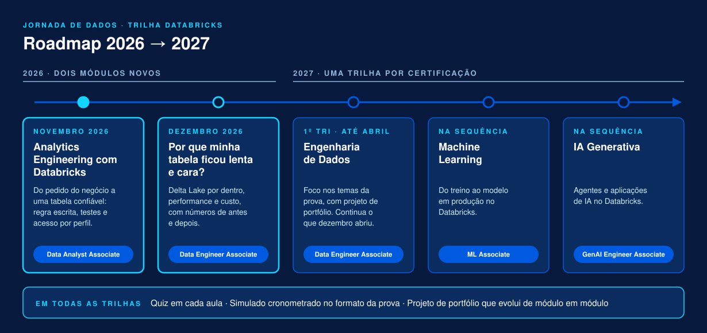

# Trilha Databricks · Jornada de Dados

Material das aulas dos novos módulos de Databricks da **Jornada de Dados**: laboratórios, slides, diagramas e documentos de apoio.
Tudo roda na **Databricks Free Edition** (custo R$ 0) e usa uma loja online fictícia como cenário.



## Roadmap

| Quando | O quê | Promessa | Certificação que apoia | Status |
|---|---|---|---|---|
| **Novembro/2026** | Módulo 01 · **Analytics Engineering com Databricks** | Do pedido do negócio a uma tabela confiável: regra escrita, testes e acesso controlado por perfil | Data Analyst Associate | 🟡 em gravação |
| **Dezembro/2026** | Módulo 02 · **Por que minha tabela ficou lenta e cara?** | Delta Lake por dentro, performance e custo, com números de antes e depois | Data Engineer Associate | ⚪ em preparação |
| **2027 · 1º trimestre (até abril)** | Trilha **Engenharia de Dados** | Os temas da prova, com projeto de portfólio. Começa onde dezembro termina | Data Engineer Associate | ⚪ planejada |
| **2027 · na sequência** | Trilha **Machine Learning** | Do treino ao modelo em produção no Databricks | Machine Learning Associate | ⚪ planejada |
| **2027 · na sequência** | Trilha **IA Generativa** | Agentes e aplicações de IA no Databricks | Generative AI Engineer Associate | ⚪ planejada |

Em 2027 a trilha segue a organização da própria Databricks: **uma trilha por certificação**. O formato (cursos novos ou módulos dentro da trilha atual), a ordem e as datas serão anunciados ao longo do ano.

### Em todas as trilhas

- **Quiz em cada aula**, com questões no estilo da prova e a explicação de cada alternativa.
- **Simulado cronometrado**, no formato da prova, com nota por tema no final.
- **Projeto de portfólio** que evolui de módulo em módulo. Cada módulo também funciona sozinho.

As questões são autorais, baseadas no guia oficial de cada prova.

## Módulos

| Módulo | O que já saiu |
|---|---|
| [01 · Analytics Engineering com Databricks](modulo-01-analytics-engineering/) | [Aula 1 · O pedido virou regra](modulo-01-analytics-engineering/aula-01-o-pedido-virou-regra/) · [Aula 2 · Ingerindo uma API de verdade](modulo-01-analytics-engineering/aula-02-ingerindo-uma-api/) |
| [02 · Por que minha tabela ficou lenta e cara?](modulo-02-delta-performance-custo/) | Ementa prevista. As aulas entram em dezembro |

As aulas são publicadas aos poucos, conforme forem gravadas. Dê **Watch** ou **Star** no repositório para acompanhar.

## Como cada módulo está organizado

```
modulo-NN-slug/
├── README.md              # o que você vai aprender, cenário e lista de aulas
├── docs/                  # documentos de apoio (ex.: contrato de dados)
├── setup/                 # prepara o ambiente do módulo (roda uma vez) + plano B
└── aula-NN-slug/
    ├── README.md          # passo a passo da aula, checkpoint e tarefa
    ├── exercicio/         # a SUA versão, com TODO para completar
    ├── solucao/           # a resposta completa, para conferir
    ├── teste/             # prova que o resultado está certo
    ├── slides.html        # abra no navegador
    ├── img/               # imagens usadas no README
    └── diagramas/         # os mesmos desenhos, editáveis em https://excalidraw.com
```

## Como começar

1. Crie uma conta na [Databricks Free Edition](https://docs.databricks.com/aws/en/getting-started/free-edition).
2. Traga este repositório para o Databricks: **Workspace → Create → Git folder** e cole a URL do repositório. Se a opção não aparecer no seu workspace, baixe os arquivos `.py` da aula e importe pela opção **Import** (os que começam com `# Databricks notebook source` viram notebooks).
3. Para receber as aulas novas, abra o Git folder e clique em **Pull**.
4. Abra o README do módulo e siga as aulas em ordem.

## Estudando com IA

Este repositório vem pronto para estudar com o [Claude Code](https://docs.claude.com/en/docs/claude-code/overview) ou outra IA:

- [`CLAUDE.md`](CLAUDE.md) diz ao Claude como te ajudar: em português, explicando o porquê e **sem entregar a solução dos exercícios de cara**.
- [`llm/`](llm/) tem o contexto do projeto (cenário, dados, API, limites da Free Edition) e prompts prontos para estudar. Se você usa outra IA, anexe os arquivos de `llm/contexto/` no começo da conversa.

## Dados

Os laboratórios usam o dataset fictício [`loja-ficticia-jornada`](https://huggingface.co/datasets/trilhajornadadatabricks/loja-ficticia-jornada) (500 clientes, 60 produtos, 1.500 pedidos e 5.416 eventos de status), consumido pela API pública do Hugging Face. Os dados foram gerados com semente fixa: todo mundo chega nos mesmos números. Não há dado real de pessoas nem de empresas.

## Pré-requisitos

Estes módulos aprofundam o que a Jornada de Dados já ensina. Vale ter feito antes:

- Módulo 1 · Fundamentos do Databricks (principalmente Unity Catalog)
- Módulo 2 · Arquitetura Medalhão
- Módulo 4 · Requisitos
- Módulo 6 · PySpark básico

---

Material da **Jornada de Dados**, conduzido por Jennifer Maia.
