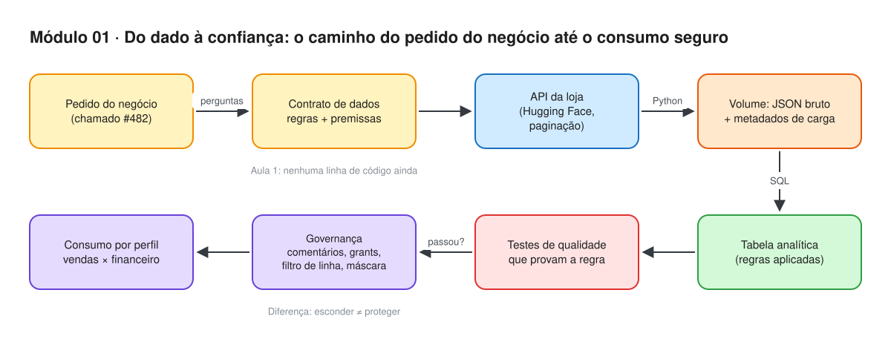
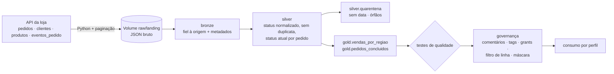

# Módulo 01 · Analytics Engineering com Databricks

> Novembro/2026 · ~3h50 em 6 aulas · apoia a certificação **Data Analyst Associate** · custo R$ 0 (Free Edition)

**Promessa:** sair de um pedido vago do negócio e entregar uma tabela analítica com regra escrita, teste que prova a regra e acesso controlado de verdade.

## O cenário

Uma loja online fictícia. A gerente comercial pede:

> “Preciso ver as vendas por região, só pedidos concluídos, sem duplicidade. O time de vendas de cada região só pode ver a própria região, e ninguém fora do financeiro pode ver e-mail e telefone de cliente.”

Antes de escrever código, transformamos esse pedido num contrato de dados: [`docs/contrato_de_dados.md`](docs/contrato_de_dados.md).

## Arquitetura



Em detalhe:



## Aulas

As aulas são publicadas aos poucos, conforme forem gravadas. Cada pasta de aula tem o próprio README com o passo a passo, o exercício e a solução.

| # | Aula | Duração | O que você faz | Status |
|---|---|---|---|---|
| 1 | [O pedido virou regra](aula-01-o-pedido-virou-regra/) | 25 min | Lê o pedido, levanta as perguntas e escreve o contrato de dados. Sem código | ✅ disponível |
| 2 | [Ingerindo uma API de verdade](aula-02-ingerindo-uma-api/) | 45 min | Paginação, retry com espera, limite de chamadas, validação de schema e JSON bruto no Volume | ✅ disponível |
| 3 | Transformação com regra rastreável | 40 min | Bronze → silver → gold, com cada regra do contrato apontando para o código | em breve |
| 4 | Testes que provam a regra | 40 min | Constraints Delta e testes de unicidade, domínio, reconciliação e regra de negócio, salvos numa tabela | em breve |
| 5 | Governança que protege de verdade | 45 min | Comentários, tags, grants, filtro de linha por região e máscara de e-mail e telefone | em breve |
| 6 | Validar o consumo e publicar | 25 min | Testa o que cada perfil enxerga e publica o projeto no seu portfólio | em breve |

## Como esta pasta está organizada

```
modulo-01-analytics-engineering/
├── README.md                       ← você está aqui
├── docs/contrato_de_dados.md       ← o contrato da aula 1: guia todas as aulas
├── setup/                          ← roda uma vez, vale para o módulo inteiro
│   ├── 01_criar_ambiente.py        ← catálogo, schemas e o Volume raw.landing
│   ├── 02_plano_b_sem_api.py       ← carrega os dados sem a API (se ela cair)
│   ├── plano_b/                    ← os dados da API em arquivo
│   └── gerar_dados_loja.py         ← como os dados fictícios foram gerados (não precisa rodar)
├── aula-01-o-pedido-virou-regra/   ← README + quiz + slides + diagramas
└── aula-02-ingerindo-uma-api/      ← README + exercicio/ + solucao/ + teste/ + quiz + slides + diagramas
```

Em toda aula com código: **`solucao/`** tem o notebook da aula, completo; **`exercicio/`** é a sua prática, com exercícios que conferem o resultado na hora (✅/❌); o gabarito fica em `solucao/`; **`teste/`** prova que o resultado está certo. Toda aula termina com um **`quiz.md`**.

Os slides são páginas HTML: baixe o arquivo e abra no navegador (`F` para tela cheia, setas para navegar).

## Para o seu portfólio

No fim do módulo você terá um repositório próprio (sugestão: `produto-dados-vendas-databricks`) com README, contrato de dados, código de ingestão, transformação, testes e governança, e prints do resultado por perfil.

## Desafios extras

1. Usar a tabela `produtos` (que já vem na aula 2) para calcular vendas por categoria.
2. Teste de reconciliação por mês (não só pelo total).
3. Gravar os manifestos da landing numa tabela Delta de controle de cargas (uma linha por carga e tabela).
