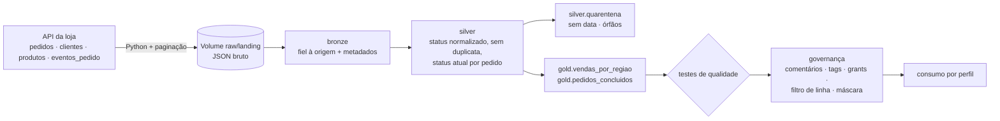

# Módulo 01 · Analytics Engineering com Databricks

> Novembro/2026 · ~3h50 em 6 aulas · apoia a certificação **Data Analyst Associate** · custo R$ 0 (Free Edition)

**Promessa:** sair de um pedido vago do negócio e entregar uma tabela analítica com regra escrita, teste que prova a regra e acesso controlado de verdade.

## O cenário

Uma loja online fictícia. A gerente comercial pede:

> “Preciso ver as vendas por região, só pedidos concluídos, sem duplicidade. O time de vendas de cada região só pode ver a própria região, e ninguém fora do financeiro pode ver e-mail e telefone de cliente.”

Antes de escrever código, transformamos esse pedido num contrato de dados: [`docs/contrato_de_dados.md`](docs/contrato_de_dados.md).

## Arquitetura

## Aulas

| # | Aula | Duração | O que você faz | Material |
|---|---|---|---|---|
| 1 | O pedido virou regra | 25 min | Lê o pedido, levanta as perguntas e escreve o contrato de dados. Sem código | [slides](slides/aula-01.html) · [contrato](docs/contrato_de_dados.md) · diagramas `aula-01-*` |
| 2 | Ingerindo uma API de verdade | 45 min | Paginação, retry com espera, limite de chamadas, validação de schema e JSON bruto no Volume | [slides](slides/aula-02.html) · [lab](lab/) · diagramas `aula-02-*` |
| 3 | Transformação com regra rastreável | 40 min | Bronze → silver → gold, com cada regra do contrato apontando para o código | em breve |
| 4 | Testes que provam a regra | 40 min | Constraints Delta e testes de unicidade, domínio, reconciliação e regra de negócio, salvos numa tabela | em breve |
| 5 | Governança que protege de verdade | 45 min | Comentários, tags, grants, filtro de linha por região e máscara de e-mail e telefone | em breve |
| 6 | Validar o consumo e publicar | 25 min | Testa o que cada perfil enxerga e publica o projeto no seu portfólio | em breve |

Os slides são páginas HTML: baixe o arquivo e abra no navegador (`F` para tela cheia, setas para navegar).

## Como rodar o lab

Passo a passo completo em [`lab/README.md`](lab/README.md). Resumo:

| Ordem | Notebook | Resultado esperado |
|---|---|---|
| 1 | `lab/setup/01_criar_ambiente` | schemas `raw`, `bronze`, `silver`, `gold`, `governanca`, `qualidade` e o Volume `raw.landing` |
| 2 | `lab/src/aula02_ingestao_api` (ou `lab/solucao/…`) | 4 pastas `landing/<tabela>/carga_<data>/` com as páginas e um `_manifesto.json` |
| 3 | `lab/tests/aula02_conferir_landing` | `Landing completa: todos os testes OK` |

Se a API estiver fora do ar ou bloqueada, rode `lab/setup/02_plano_b_sem_api`: ele grava os mesmos dados, no mesmo formato.

## Para o seu portfólio

No fim do módulo você terá um repositório próprio (sugestão: `produto-dados-vendas-databricks`) com README, contrato de dados, código de ingestão, transformação, testes e governança, e prints do resultado por perfil.

## Desafios extras

1. Ingerir também `/products` e calcular vendas por categoria.
2. Teste de reconciliação por mês (não só pelo total).
3. Fazer a ingestão parar com mensagem clara se a API mudar o formato.
