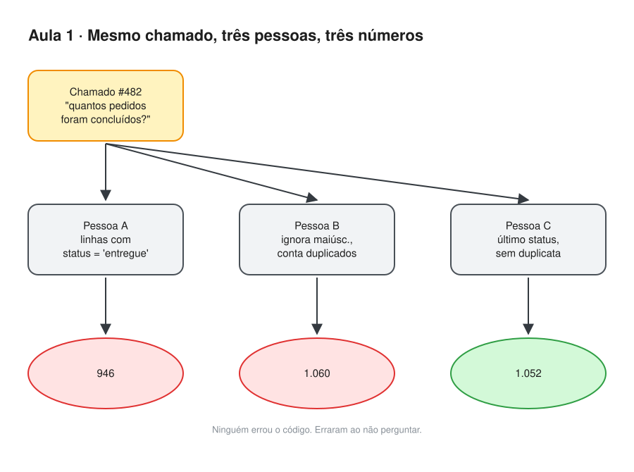
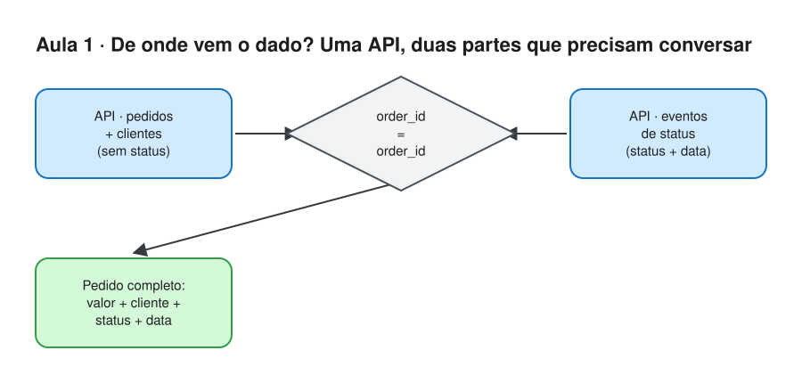
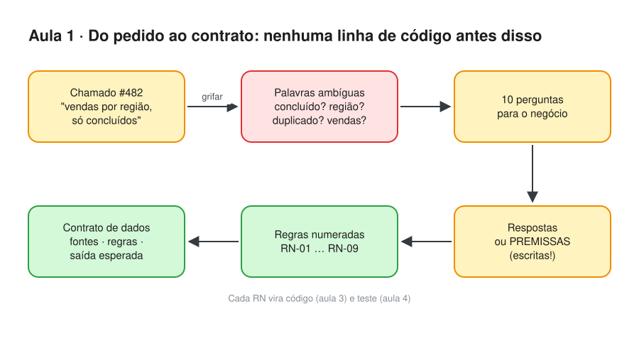

# Aula 1 · O pedido virou regra

> Módulo 01 · Analytics Engineering com Databricks · ~25 min · **sem código**

**Nesta aula você transforma um pedido vago do negócio num contrato de dados:** perguntas, premissas escritas e regras numeradas, antes de abrir o notebook.

| | |
|---|---|
| Você vai precisar de | só os slides e o contrato. Nada de Databricks hoje |
| Você sai com | o [contrato de dados](../docs/contrato_de_dados.md) do projeto, que guia as aulas 2 a 6 |
| Material | [slides](https://jennifer-maia.github.io/trilha-databricks-aulas/modulo-01-analytics-engineering/aula-01-o-pedido-virou-regra/slides.html) (abre no navegador) · [contrato](../docs/contrato_de_dados.md) · [quiz](https://jennifer-maia.github.io/trilha-databricks-aulas/quiz/?aula=01) · [diagramas](diagramas/) |

## O problema

> “Por que esse número não bate com o do financeiro?”

Quase nunca é um bug no código. Quase sempre é uma pergunta que ninguém fez antes de começar.

## O chamado

A gerente comercial (fictícia) da nossa loja online abre um chamado:

> Preciso ver as **vendas** por **região**, considerando só pedidos **concluídos** e **sem duplicidade**, porque o número do último relatório não bateu com o financeiro.
> O time de vendas de cada região só pode ver a **própria região**. E ninguém fora do **financeiro** pode ver e-mail e telefone de cliente.

Parece claro. Mas cada palavra em negrito esconde uma decisão: vendas com ou sem desconto? Região do cliente ou da entrega? Concluído é pago, enviado ou entregue?

## Mesmo chamado, três pessoas, três números

Três pessoas recebem o chamado e cada uma calcula *quantos pedidos foram concluídos*. Ninguém errou o código. Erraram ao **não perguntar**.

Os números são reais: o dataset da loja foi gerado com semente fixa, então você vai chegar nos mesmos valores nas próximas aulas.

## De onde vem o dado

A loja publica os dados numa API. O pedido não diz se foi entregue nem quando: isso fica numa outra tabela, de eventos de status. As duas se ligam pelo número do pedido.

## Do pedido ao contrato

Para cada palavra ambígua, uma pergunta ao negócio. Enquanto a resposta não chega, uma **premissa escrita**. Cada resposta ou premissa vira uma **regra numerada** (RN-01 a RN-09), que na aula 3 vira código e na aula 4 vira teste.

> **Premissa não é chute.** É uma decisão escrita, com dono, que alguém pode confirmar ou corrigir. Se não está escrita, ninguém sabe que você assumiu.

O contrato completo, com as 10 perguntas, as 9 regras, a saída esperada e o que fica fora do escopo: [`docs/contrato_de_dados.md`](../docs/contrato_de_dados.md).

## Sua tarefa

1. Copie o [contrato](../docs/contrato_de_dados.md) para o seu repositório de portfólio.
2. Responda: **o que você perguntaria à gerente que não está no contrato?** Escreva a pergunta e a premissa que você assumiria.
3. Faça o [quiz da aula](https://jennifer-maia.github.io/trilha-databricks-aulas/quiz/?aula=01): 8 perguntas sobre o chamado e o contrato. Cada resposta mostra na hora se está certa e por quê.

## Próxima aula

[Aula 2 · Ingerindo uma API de verdade](../aula-02-ingerindo-uma-api/): buscar esses dados na API e descobrir por que um simples `requests.get` traz só 100 dos 1.500 pedidos.

---

Os desenhos estão em `diagramas/` no formato `.excalidraw`: abra em [excalidraw.com](https://excalidraw.com) (menu → Abrir) para editar ou reaproveitar no seu portfólio.
