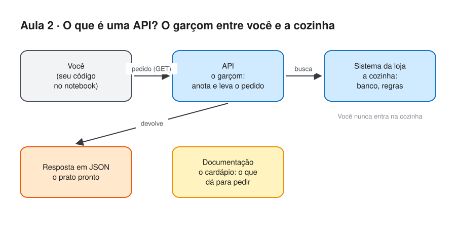
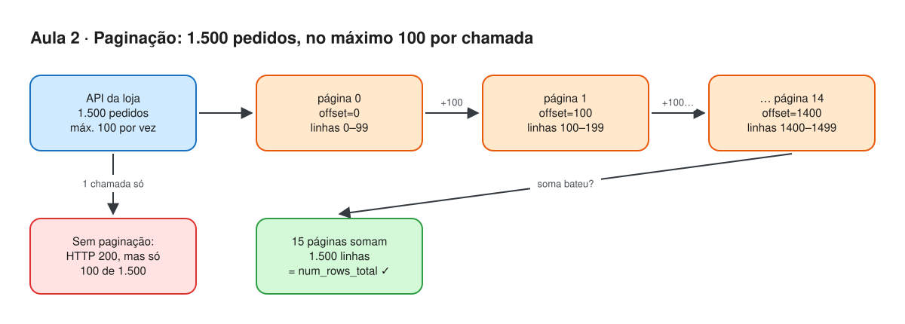
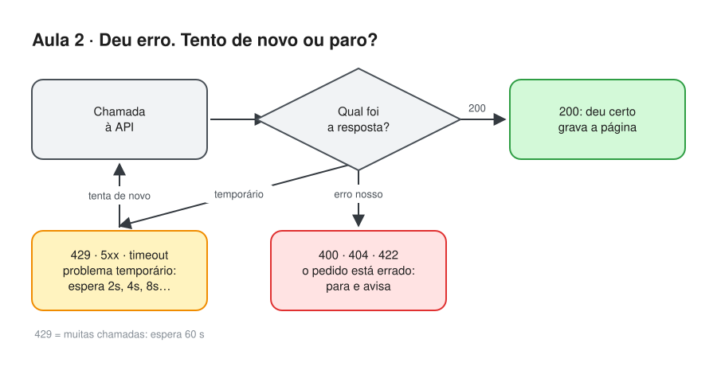
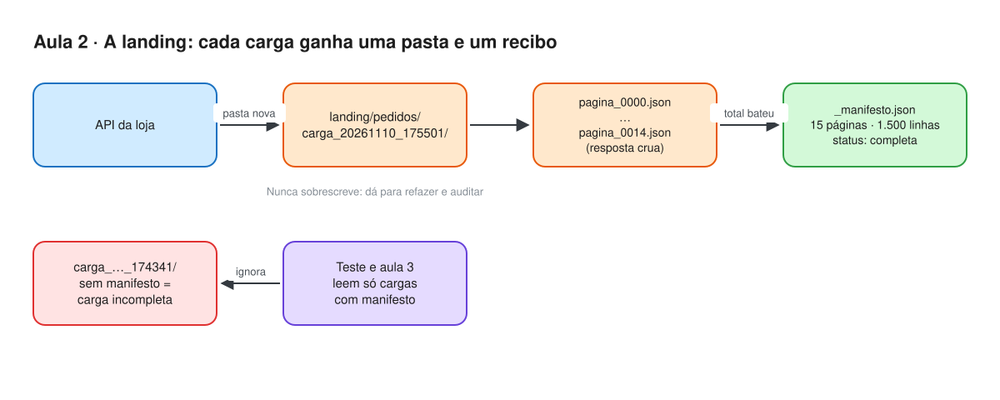
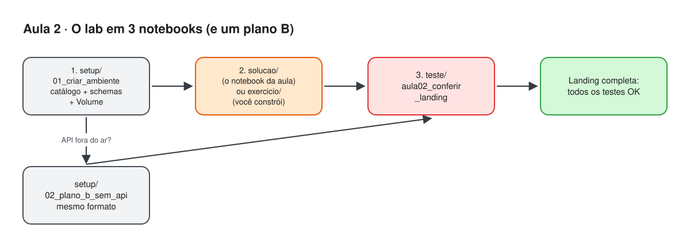

# Aula 2 · Ingerindo uma API de verdade

> Módulo 01 · Analytics Engineering com Databricks · ~45 min · Databricks Free Edition (custo R$ 0)

**Nesta aula você busca as 4 tabelas da loja numa API pública e guarda as respostas, do jeito que vieram, num Volume do Unity Catalog, com um recibo que prova que veio tudo.**

| | |
|---|---|
| Você vai precisar de | conta na [Databricks Free Edition](https://docs.databricks.com/aws/en/getting-started/free-edition) e o [contrato da aula 1](../docs/contrato_de_dados.md) |
| Você sai com | 4 tabelas no Volume `raw.landing` (500 clientes, 60 produtos, 1.500 pedidos, 5.416 eventos), com manifesto e teste verde |
| Material | [slides](https://jennifer-maia.github.io/trilha-databricks-aulas/modulo-01-analytics-engineering/aula-02-ingerindo-uma-api/slides.html) (abre no navegador) · [anotações passo a passo](anotacoes.md) · [quiz](https://jennifer-maia.github.io/trilha-databricks-aulas/quiz/?aula=02) · [diagramas](diagramas/) |

## O que você vai aprender

- O que é uma API e como ler a resposta dela (JSON).
- Por que **HTTP 200 não quer dizer "veio tudo"**, e como a paginação resolve.
- Quando tentar de novo (retry com espera que dobra) e quando parar.
- Como lidar com o limite de chamadas da API (o famoso 429).
- Como conferir as colunas contra o contrato na entrada.
- Como guardar o dado cru, uma pasta por carga, com manifesto.

## Os conceitos, em desenho

### O que é uma API?

Você (o seu código) faz o pedido ao garçom (a API), que leva até a cozinha (o sistema da loja) e traz o prato (a resposta em JSON). Ninguém te dá a senha do banco: a API é a porta controlada.



### Paginação: 1.500 pedidos, no máximo 100 por chamada



### Deu erro. Tento de novo ou paro?

| Código | Quem errou | O que fazer |
|---|---|---|
| 200 | ninguém | seguir |
| 400, 404, 422 | nós (pedido errado) | **parar** e corrigir |
| 429 | ninguém: chamadas demais | esperar e tentar de novo |
| 500, 502, 503, 504 | o servidor | esperar e tentar de novo |
| timeout | a rede | esperar e tentar de novo |



### A landing: uma pasta por carga, com recibo



## O laboratório



### O que tem nesta pasta

```
aula-02-ingerindo-uma-api/
├── solucao/aula02_ingestao_api.py          ← o notebook da aula, completo
├── exercicio/aula02_exercicios.py          ← a SUA prática: 6 exercícios para construir a ingestão
├── solucao/aula02_exercicios_gabarito.py   ← o gabarito dos exercícios (tente antes de olhar!)
├── teste/aula02_conferir_landing.py        ← prova que a landing veio completa
├── anotacoes.md                            ← minhas notas sobre cada passo do notebook, com as saídas esperadas
├── slides.html
├── img/ e diagramas/
```

Os notebooks de preparação ficam na pasta [`setup/`](../setup/) do módulo, porque servem para todas as aulas.

### Passo a passo

**Antes de tudo:** traga o repositório para o Databricks (veja [Como começar](../../README.md#como-começar)) e, em cada notebook, conecte no **Serverless** (botão *Connect*, no topo). Rode **célula por célula** com `Shift+Enter` e leia a saída antes de seguir.

| Ordem | Notebook | O que faz | Resultado esperado |
|---|---|---|---|
| 1 | [`setup/01_criar_ambiente`](../setup/01_criar_ambiente.py) | Cria o catálogo, os schemas e o Volume | schemas `raw`, `bronze`, `silver`, `gold`, `governanca`, `qualidade` e o Volume `raw.landing` |
| 2 | [`solucao/aula02_ingestao_api`](solucao/aula02_ingestao_api.py) | O notebook da aula: busca as 4 tabelas na API e grava na landing | `clientes: 500 linhas em 5 páginas` … `eventos_pedido: 5416 linhas em 55 páginas` |
| 3 | [`teste/aula02_conferir_landing`](teste/aula02_conferir_landing.py) | Confere total, linhas repetidas e colunas | `Landing completa: todos os testes OK` |

Em todos os notebooks, o widget `catalogo` (a caixinha no topo) precisa ter o mesmo valor. O padrão é `jornada_comercial`.

### Agora é com você: os exercícios

Assistir à ingestão pronta é diferente de construir. Em [`exercicio/aula02_exercicios`](exercicio/aula02_exercicios.py) você monta a ingestão do zero, um pedaço por vez. Cada exercício tem uma célula **Conferir**, que mostra ✅ ou ❌ para cada caso.

| # | Exercício | O que você constrói |
|---|---|---|
| 1 | Ler a resposta | a chamada à API, achando o total e as colunas no JSON |
| 2 | Quem errou? | `classificar(status)`: seguir, parar ou tentar de novo |
| 3 | Quantas chamadas? | `planejar_offsets(total)`: o plano da paginação |
| 4 | Tentar de novo | `com_retry(...)`, testado numa API de mentira (sem esperar minutos de 429) |
| 5 | A fonte mudou? | `comparar_colunas(...)`: o que falta e o que veio a mais |
| 6 | A carga de verdade | `baixar(tabela)`: junta tudo e grava na landing, com manifesto |

No fim, o seu código busca as 4 tabelas e você roda o `teste/`. Se ficar verde, a sua ingestão serve para a aula 3.

Travou? Primeiro leia as [anotações](anotacoes.md). Depois o [gabarito](solucao/aula02_exercicios_gabarito.py).

### Erros de propósito

O notebook mostra três erros antes de chegar na solução. **É para dar erro**, não se assuste:

| Erro | O que você vai ver | A lição |
|---|---|---|
| 1 · A rede deixa? | um site `SEM ACESSO → ConnectTimeout` | antes de culpar o código, teste a rede |
| 2 · Pedir 1.000 linhas | `422 → Parameter 'length' must not be greater than 100` | 4xx = o pedido está errado; tentar de novo não resolve |
| 3 · Uma chamada só | `Status 200 \| vieram 100 de 1500 pedidos` | o erro mais perigoso é o que não dá erro |

## Checkpoint

Deu certo se você vê:

| Tabela | Linhas | Páginas |
|---|---|---|
| clientes | 500 | 5 |
| produtos | 60 | 1 |
| pedidos | 1.500 | 15 |
| eventos_pedido | 5.416 | 55 |

E o teste termina com `Landing completa: todos os testes OK`.

## Se algo der errado

| Aconteceu | Por quê | O que fazer |
|---|---|---|
| `HTTP 429 ... nova tentativa em 60s` | A API limita as chamadas por minuto. A carga toda são 76 chamadas e, nos nossos testes, o limite apareceu depois de ~40 a 55 | Nada: é o retry funcionando. A carga leva de 2 a 6 minutos |
| `HTTP 502` ou `503` | O servidor da API oscilou | Nada: o retry tenta de novo |
| `ConnectTimeout` no Hugging Face | A Free Edition só acessa uma lista de sites liberados, que muda sem aviso | Use o plano B (abaixo) |
| `Desisti após 6 tentativas` | A API ficou fora do ar por muito tempo | Espere alguns minutos e rode de novo, ou use o plano B |
| `NameError: name 'CAT' is not defined` | A sessão reiniciou e as variáveis sumiram | Rode de novo a célula do **Passo 0** |
| `Aviso: ... sem manifesto (carga incompleta, ignorada)` no teste | Uma carga anterior parou no meio | Nada: é o manifesto fazendo o trabalho dele |

**Plano B:** se a API estiver bloqueada ou fora do ar, rode [`setup/02_plano_b_sem_api`](../setup/02_plano_b_sem_api.py). Ele grava os mesmos dados, no mesmo formato, e o resto do curso funciona igual. Depois rode o teste normalmente.

## Sua tarefa

1. Faça os 6 exercícios de [`exercicio/aula02_exercicios`](exercicio/aula02_exercicios.py) até tudo ficar ✅, sem olhar o gabarito. Depois rode o teste até ficar verde.
2. Faça o [quiz da aula](https://jennifer-maia.github.io/trilha-databricks-aulas/quiz/?aula=02): 10 perguntas, com a nota no final. As marcadas com 🎓 são sobre a plataforma Databricks.
3. **Desafio:** em `COLUNAS_ESPERADAS`, troque `valor_liquido` por `valor_liq` e rode a carga de `pedidos`. O que acontece? Por que é bom que a carga quebre aqui, e não três semanas depois num relatório?
4. Para o portfólio: coloque no seu repositório o notebook, um print do checkpoint e uma frase explicando por que você guarda o dado cru.

## Próxima aula

**Aula 3 · Transformação com regra rastreável** (em breve): abrir esses JSON e transformar em bronze, silver e gold, com cada regra do contrato apontando para o código.

---

Fonte dos dados: [`loja-ficticia-jornada`](https://huggingface.co/datasets/trilhajornadadatabricks/loja-ficticia-jornada) no Hugging Face, lida pela API pública `datasets-server` (endpoint `/rows`, até 100 linhas por chamada, sem autenticação). O limite de chamadas foi medido em 10/11/2026 e não está documentado para esse endpoint: pode mudar.
