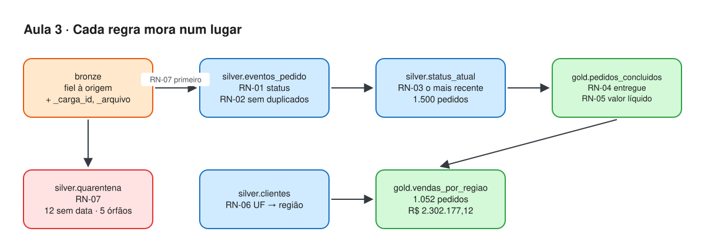
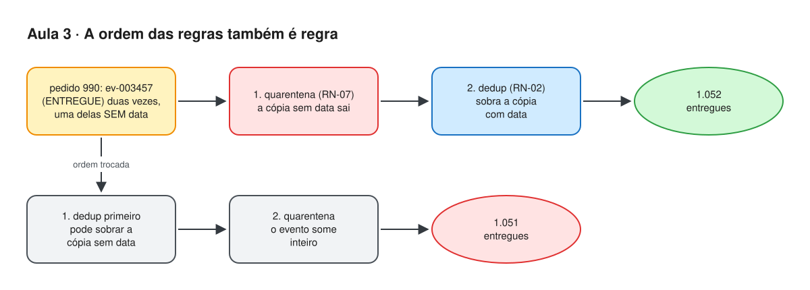
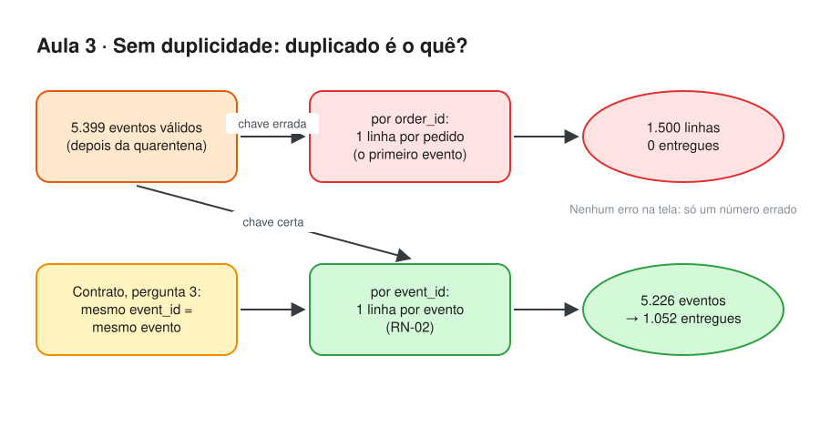

# Aula 3 · Transformação com regra rastreável

> Módulo 01 · Analytics Engineering com Databricks · ~52 min · Databricks Free Edition (custo R$ 0)

**Nesta aula você transforma o JSON cru da landing em bronze, silver e gold, e cada regra do contrato vira um trecho de SQL marcado com o número dela.**

| | |
|---|---|
| Você vai precisar de | a landing completa da [aula 2](../aula-02-ingerindo-uma-api/) e o [contrato de dados](../docs/contrato_de_dados.md) |
| Você sai com | `silver.status_atual` com 1 linha por pedido e `gold.vendas_por_regiao` com **1.052 pedidos concluídos** (R$ 2.302.177,12) |
| Material | [slides](https://jennifer-maia.github.io/trilha-databricks-aulas/modulo-01-analytics-engineering/aula-03-transformacao-rastreavel/slides.html) (abre no navegador) · [anotações passo a passo](anotacoes.md) · [quiz](https://jennifer-maia.github.io/trilha-databricks-aulas/quiz/?aula=03) · [diagramas](diagramas/) |

## O que você vai aprender

- Por que a bronze **não aplica regra nenhuma**, e quais metadados ela guarda.
- Como escrever cada regra do contrato em SQL, com o número dela no código (`-- RN-02`).
- Por que a **ordem** das regras muda o resultado.
- Como uma deduplicação pela chave errada some com 3.700 eventos sem dar erro nenhum.
- Como chegar no 1.052 da aula 1, e provar de onde ele vem.

## Os conceitos, em desenho

### Cada regra mora num lugar

Quando alguém perguntar "de onde vem esse número?", a resposta cabe numa frase: a regra, a tabela e a linha do código.



| Regra | O que diz | Onde fica |
|---|---|---|
| RN-07 | evento sem data ou de pedido que não existe vai para a quarentena | `silver.quarentena` |
| RN-01 | uma grafia por status (`Entregue`, `delivered` → `entregue`) | `silver.eventos_pedido` |
| RN-02 | evento duplicado (mesmo `event_id`) conta uma vez | `silver.eventos_pedido` |
| RN-03 | status atual = evento mais recente do pedido | `silver.status_atual` |
| RN-04 | concluído = status atual `entregue` | `gold.pedidos_concluidos` |
| RN-05 | venda = `valor_liquido` | `gold.pedidos_concluidos` |
| RN-06 | UF do cliente → região do IBGE; sem UF → `Não informada` | `silver.clientes` |

### A ordem das regras também é regra



### Duplicado é o quê?



## O laboratório

### O que tem nesta pasta

```
aula-03-transformacao-rastreavel/
├── solucao/aula03_transformacao.py         ← o notebook da aula, completo
├── exercicio/aula03_exercicios.py          ← a SUA prática: 5 regras para escrever em SQL
├── solucao/aula03_exercicios_gabarito.py   ← o gabarito dos exercícios (tente antes de olhar!)
├── teste/aula03_conferir_camadas.py        ← prova que as camadas seguem o contrato
├── anotacoes.md                            ← minhas notas sobre cada passo, com as saídas esperadas
├── slides.html
├── img/ e diagramas/
```

### Passo a passo

**Antes de tudo:** a landing da aula 2 precisa estar completa (o teste da aula 2 verde). Conecte no **Serverless** e rode **célula por célula**.

| Ordem | Notebook | O que faz | Resultado esperado |
|---|---|---|---|
| 1 | [`solucao/aula03_transformacao`](solucao/aula03_transformacao.py) | Bronze, silver e gold, com as regras do contrato | tabela final do Passo 9 toda `OK` |
| 2 | [`teste/aula03_conferir_camadas`](teste/aula03_conferir_camadas.py) | Confere cada regra e a reconciliação | `Camadas conferidas: todos os testes OK` |

O widget `catalogo` precisa ter o mesmo valor da aula 2. O padrão é `jornada_comercial`.

### Agora é com você: os exercícios

Em [`exercicio/aula03_exercicios`](exercicio/aula03_exercicios.py) você escreve cada regra em SQL. Cada `SELECT` vira uma *view temporária* (não mexe nas tabelas da aula) e a célula **Conferir** mostra ✅ ou ❌.

| # | Exercício | Regra |
|---|---|---|
| 1 | Uma grafia por status | RN-01 |
| 2 | Quarentena | RN-07 |
| 3 | Sem duplicados, pela chave certa | RN-02 |
| 4 | Status atual de cada pedido | RN-03 |
| 5 | Vendas por região e mês | RN-04, RN-05, RN-06 |

Travou? Primeiro leia as [anotações](anotacoes.md). Depois o [gabarito](solucao/aula03_exercicios_gabarito.py).

### Erro de propósito

| Erro | O que você vai ver | A lição |
|---|---|---|
| Deduplicar por `order_id` | `1500` linhas e `0` entregues | duplicado, no contrato, é o mesmo **evento**: a chave é `event_id` |

## Checkpoint

| Tabela | Esperado |
|---|---|
| `bronze.eventos_pedido` | 5.416 linhas (tudo o que veio, sem regra) |
| `silver.quarentena` | 17 (12 `sem_data` + 5 `pedido_inexistente`) |
| `silver.eventos_pedido` | 5.226 eventos, 5 status |
| `silver.status_atual` | 1.500 linhas, 1 por pedido, **1.052 entregues** |
| `gold.vendas_por_regiao` | 17 linhas (região × mês), soma R$ 2.302.177,12, 4 pedidos em `Não informada` |

## Se algo der errado

| Aconteceu | Por quê | O que fazer |
|---|---|---|
| `nenhuma carga completa na landing` | A aula 2 não terminou, ou o catálogo do widget é outro | Rode o teste da aula 2. Se precisar, use o plano B |
| `TABLE_OR_VIEW_NOT_FOUND` numa célula SQL | O `USE CATALOG` do Passo 0 não rodou (a sessão reiniciou) | Rode de novo a célula do **Passo 0** |
| 1.051 entregues em vez de 1.052 | A deduplicação veio antes da quarentena | Veja o desenho "A ordem das regras" acima |
| 1.060 ou 1.101 entregues | Faltou tirar duplicados ou a RN-03 | Confira o Passo 4 e o Passo 5 |

## Sua tarefa

1. Faça os 5 exercícios de [`exercicio/aula03_exercicios`](exercicio/aula03_exercicios.py) até tudo ficar ✅. Depois rode o teste.
2. Faça o [quiz da aula](https://jennifer-maia.github.io/trilha-databricks-aulas/quiz/?aula=03).
3. Para o portfólio: um print do checkpoint do Passo 9 e uma frase explicando por que a quarentena vem antes da deduplicação.

## Próxima aula

**[Aula 4 · Testes que provam a regra](../aula-04-testes-que-provam/)**: transformar o checkpoint desta aula em testes de verdade, salvos numa tabela, com constraints Delta.
