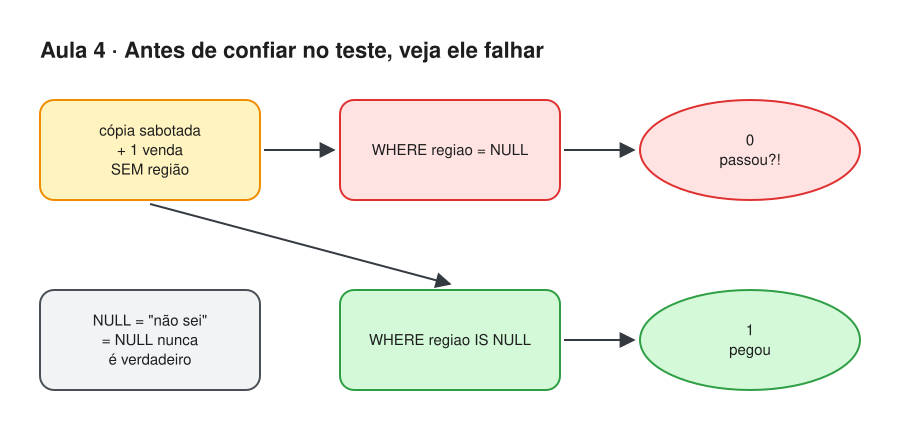
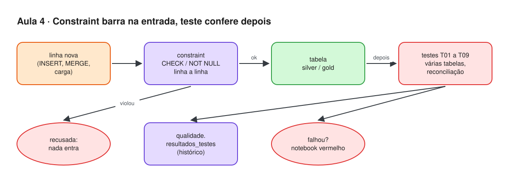

# Aula 4 · Testes que provam a regra

> Módulo 01 · Analytics Engineering com Databricks · ~48 min · Databricks Free Edition (custo R$ 0)

**Nesta aula, cada regra do contrato ganha um teste com o mesmo número. O resultado fica salvo numa tabela com histórico, e as constraints do Delta passam a barrar dado ruim na entrada.**

| | |
|---|---|
| Você vai precisar de | as camadas da [aula 3](../aula-03-transformacao-rastreavel/) prontas (teste da aula 3 verde) |
| Você sai com | `qualidade.resultados_testes` com **9 testes OK** em cada rodada, e constraints em `silver.status_atual` e `silver.pedidos` |
| Material | [slides](https://jennifer-maia.github.io/trilha-databricks-aulas/modulo-01-analytics-engineering/aula-04-testes-que-provam/slides.html) (abre no navegador) · [anotações passo a passo](anotacoes.md) · [quiz](https://jennifer-maia.github.io/trilha-databricks-aulas/quiz/?aula=04) · [diagramas](diagramas/) |

## O que você vai aprender

- O que um teste precisa ter além de mostrar `OK`: **falhar em vermelho** e **deixar registro**.
- Um formato só para todos os testes: um `SELECT` que **conta as linhas ruins** (0 = passou).
- Os tipos de teste: unicidade, domínio, não nulo, reconciliação, regra de negócio e regressão.
- Por que um teste que nunca falhou pode não estar testando nada, e como provar que ele funciona (sabotagem).
- A diferença entre **teste** (confere depois) e **constraint** do Delta (recusa na entrada).

## Os conceitos, em desenho

### Antes de confiar no teste, veja ele falhar



### Constraint barra na entrada, teste confere depois



| | Teste | Constraint |
|---|---|---|
| Quando age | depois de escrever | na hora de escrever |
| O que olha | qualquer coisa, até várias tabelas | uma linha de cada vez, de uma tabela |
| Se der problema | registra e avisa | recusa a escrita inteira |

## Os testes do contrato

| Teste | Regra | Tipo | Pergunta |
|---|---|---|---|
| T01 | RN-07 | regra de negócio | algum evento sem data ou de pedido inexistente passou para a silver? |
| T02 | RN-01 | domínio | algum status fora dos 5 do contrato (ou vazio)? |
| T03 | RN-02 | unicidade | algum `event_id` repetido? |
| T04 | RN-03 | unicidade | algum pedido com mais de um status atual? |
| T05 | RN-04 | regra de negócio | algum pedido concluído que não está `entregue`? |
| T06 | RN-05 | reconciliação | algum valor de venda diferente do `valor_liquido` do pedido? |
| T07 | RN-06 | não nulo | alguma venda sem região? |
| T08 | RN-05 | reconciliação | a soma do resumo bate com a soma do detalhe? |
| T09 | RN-04 | regressão | continuam sendo 1.052 pedidos concluídos? |

## O laboratório

### O que tem nesta pasta

```
aula-04-testes-que-provam/
├── solucao/aula04_testes_qualidade.py      ← o notebook da aula, completo
├── exercicio/aula04_exercicios.py          ← a SUA prática: 4 testes e 1 constraint
├── solucao/aula04_exercicios_gabarito.py   ← o gabarito dos exercícios (tente antes de olhar!)
├── teste/aula04_conferir_qualidade.py      ← prova que os testes e as constraints estão no lugar
├── anotacoes.md                            ← minhas notas sobre cada passo, com as saídas esperadas
├── slides.html
├── img/ e diagramas/
```

### Passo a passo

**Antes de tudo:** as camadas da aula 3 precisam existir (o teste da aula 3 verde). Conecte no **Serverless** e rode **célula por célula**.

| Ordem | Notebook | O que faz | Resultado esperado |
|---|---|---|---|
| 1 | [`solucao/aula04_testes_qualidade`](solucao/aula04_testes_qualidade.py) | Testes, histórico e constraints | `Rodada ...: 9 testes, todos OK` |
| 2 | [`teste/aula04_conferir_qualidade`](teste/aula04_conferir_qualidade.py) | Confere a tabela de resultados e as constraints | `Qualidade conferida: todos os testes OK` |

O widget `catalogo` precisa ter o mesmo valor das aulas anteriores. O padrão é `jornada_comercial`.

### Agora é com você: os exercícios

Em [`exercicio/aula04_exercicios`](exercicio/aula04_exercicios.py) você escreve os testes. A célula **Conferir** roda cada teste duas vezes: na tabela de verdade (tem que dar 0) e numa **cópia sabotada** (tem que dar mais que 0). Assim você prova que o seu teste funciona.

| # | Exercício | Tipo | Regra |
|---|---|---|---|
| 1 | Um status por pedido | unicidade | RN-03 |
| 2 | Só os 5 status do contrato | domínio | RN-01 |
| 3 | O resumo bate com o detalhe | reconciliação | RN-05 |
| 4 | Todo concluído está entregue | regra de negócio | RN-04 |
| 5 | Barrar na entrada | constraint | RN-05 |

Travou? Primeiro leia as [anotações](anotacoes.md). Depois o [gabarito](solucao/aula04_exercicios_gabarito.py).

### Erro de propósito

| Erro | O que você vai ver | A lição |
|---|---|---|
| Testar nulo com `= NULL` | o teste dá `0` mesmo com uma venda sem região | para nulo, é `IS NULL`; e todo teste precisa ser visto falhando uma vez |

## Checkpoint

| Onde | Esperado |
|---|---|
| Passo 3 | 9 linhas, todas `OK`, `linhas_ruins = 0` |
| Passo 4 | 2 rodadas no histórico (ou mais, se você rodou de novo) |
| Passo 6 | as duas tentativas `recusado` e `0` linhas de teste na tabela |
| Teste | `Qualidade conferida: todos os testes OK` |

## Se algo der errado

| Aconteceu | Por quê | O que fazer |
|---|---|---|
| `TABLE_OR_VIEW_NOT_FOUND` | A aula 3 não rodou nesse catálogo, ou a sessão reiniciou | Rode o **Passo 0** de novo; se continuar, rode a aula 3 |
| Algum teste `FALHOU` | Uma regra da aula 3 não foi aplicada | Rode o teste da aula 3 para ver qual camada está errada |
| `linhas_ruins = -1` | O SQL do teste nem rodou (nome de tabela ou coluna errado) | Leia a mensagem impressa acima da tabela |
| Erro ao criar a constraint | Já existe dado que viola a regra | Confira a camada com o teste da aula 3. A constraint só entra se **todas** as linhas respeitarem a regra |
| O teste diz que a constraint sumiu | Você rodou a aula 3 de novo: o `CREATE OR REPLACE` recria a tabela | Rode este notebook de novo, depois da aula 3 |

## Sua tarefa

1. Faça os 5 exercícios de [`exercicio/aula04_exercicios`](exercicio/aula04_exercicios.py) até tudo ficar ✅. Depois rode o teste.
2. Faça o [quiz da aula](https://jennifer-maia.github.io/trilha-databricks-aulas/quiz/?aula=04).
3. Para o portfólio: um print do histórico (Passo 4) e uma frase explicando a diferença entre teste e constraint.

## Próxima aula

**Aula 5 · Governança que protege de verdade** (em breve): comentários, tags, grants, filtro de linha por região e máscara em e-mail e telefone.
