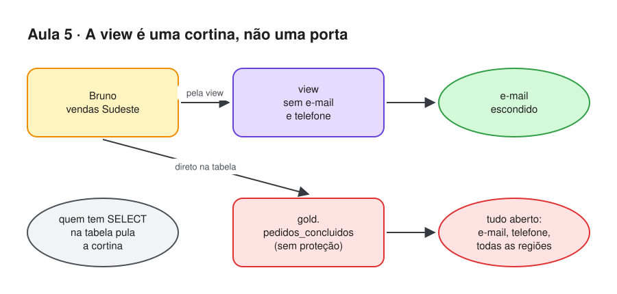
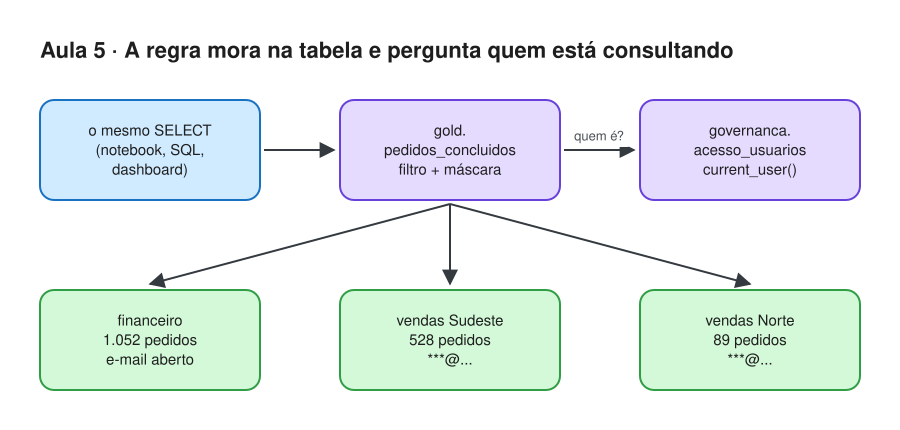
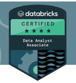

# Aula 5 · Governança que protege de verdade

> Módulo 01 · Analytics Engineering com Databricks · ~50 min · Databricks Free Edition (custo R$ 0)

**Nesta aula, as duas regras de acesso do contrato saem do documento e vão para a tabela: quem é de vendas só vê a própria região (RN-08), e e-mail e telefone só aparecem para o financeiro (RN-09). E, como toda regra do projeto, elas ganham testes.**

| | |
|---|---|
| Você vai precisar de | as aulas [3](../aula-03-transformacao-rastreavel/) e [4](../aula-04-testes-que-provam/) rodadas no mesmo catálogo (testes das duas verdes) |
| Você sai com | filtro de linha nas duas tabelas gold, máscara em e-mail e telefone, `governanca.acesso_usuarios` e **4 testes de governança OK** em `qualidade.resultados_testes` |
| Material | [slides](https://jennifer-maia.github.io/trilha-databricks-aulas/modulo-01-analytics-engineering/aula-05-governanca-que-protege/slides.html) (abre no navegador) · [anotações passo a passo](anotacoes.md) · [quiz](https://jennifer-maia.github.io/trilha-databricks-aulas/quiz/?aula=05) · [diagramas](diagramas/) |

## O que você vai aprender

- Documentar antes de proteger: **comentários** em tabela e coluna, e **tags** para achar dado pessoal.
- Por que uma **view que esconde colunas não protege** quem consegue ler a tabela.
- **Filtro de linha** (row filter) e **máscara de coluna** (column mask): funções SQL presas na própria tabela.
- De onde vem o perfil de quem consulta: grupos no mundo real, **tabela de acesso** aqui.
- `GRANT`: os três privilégios para ler uma tabela (`USE CATALOG`, `USE SCHEMA`, `SELECT`).
- Testar governança **dos dois lados**: não vazar, e não esconder demais.

## Os conceitos, em desenho

### A view é uma cortina, não uma porta



### A regra mora na tabela e pergunta quem está consultando



| | Filtro de linha | Máscara de coluna |
|---|---|---|
| Recebe | o valor de uma coluna da linha (aqui, `regiao`) | o valor da coluna protegida (aqui, `email` ou `telefone`) |
| Devolve | `TRUE` (a linha aparece) ou `FALSE` (some) | o que a pessoa vai ver |
| Regra | RN-08 | RN-09 |

Doc oficial: [Row filters and column masks](https://docs.databricks.com/aws/en/tables/row-and-column-filters) · [Privilégios do Unity Catalog](https://docs.databricks.com/aws/en/data-governance/unity-catalog/manage-privileges/)

## Os perfis

| Perfil | Regiões | E-mail e telefone |
|---|---|---|
| `financeiro` | todas | abertos |
| `vendas` + região | só a sua | mascarados: `***@exemplo.com.br` e `(**) *****-1234` |

Quem é de qual perfil está em `governanca.acesso_usuarios`. Na Free Edition dá para criar grupos, mas o teste é feito com uma conta só (a sua), então a aula **troca o seu perfil** nessa tabela para ver o que cada um enxerga. Os outros usuários da tabela (`@loja-ficticia.com`) são inventados.

## O laboratório

### O que tem nesta pasta

```
aula-05-governanca-que-protege/
├── solucao/aula05_governanca.py            ← o notebook da aula, completo
├── exercicio/aula05_exercicios.py          ← a SUA prática: proteger uma cópia de clientes e provar
├── solucao/aula05_exercicios_gabarito.py   ← o gabarito dos exercícios (tente antes de olhar!)
├── teste/aula05_conferir_governanca.py     ← prova que a proteção funciona, perfil por perfil
├── anotacoes.md                            ← minhas notas sobre cada passo, com as saídas esperadas
├── slides.html
├── img/ e diagramas/
```

### Passo a passo

**Antes de tudo:** os testes das aulas 3 e 4 verdes no mesmo catálogo. Conecte no **Serverless** e rode **célula por célula**.

| Ordem | Notebook | O que faz | Resultado esperado |
|---|---|---|---|
| 1 | [`solucao/aula05_governanca`](solucao/aula05_governanca.py) | Documenta, protege e testa as tabelas gold | `Governança conferida (...): RN-08 e RN-09 OK, e você está de volta no perfil financeiro` |
| 2 | [`teste/aula05_conferir_governanca`](teste/aula05_conferir_governanca.py) | Troca o seu perfil e confere o que aparece | `Governança conferida: todos os testes OK` |

O widget `catalogo` precisa ter o mesmo valor das aulas anteriores. O padrão é `jornada_comercial`.

### Agora é com você: os exercícios

Em [`exercicio/aula05_exercicios`](exercicio/aula05_exercicios.py) você protege `governanca.ex05_clientes`, uma cópia de `silver.clientes` só sua. As conferências trocam o seu perfil para testar e **sempre voltam você para `financeiro`**.

| # | Exercício | Regra |
|---|---|---|
| 1 | Marcar as colunas de dado pessoal com a tag `pii` | documentação |
| 2 | Função de máscara para o telefone | RN-09 |
| 3 | Pôr a máscara na coluna | RN-09 |
| 4 | Função de filtro e filtro na tabela | RN-08 |
| 5 | Um teste que prova o filtro (e falha sem ele) | RN-08 |

Travou? Primeiro leia as [anotações](anotacoes.md). Depois o [gabarito](solucao/aula05_exercicios_gabarito.py).

### Erro de propósito

| Erro | O que você vai ver | A lição |
|---|---|---|
| Uma view sem e-mail e telefone para "proteger" | pela view, nada de contato; consultando a tabela, tudo aberto | a proteção vai **na tabela**; a view é só uma cortina |

## Checkpoint

| Onde | Esperado |
|---|---|
| Passo 1 | `email` e `telefone` com a tag `pii` |
| Passo 5 | financeiro: **6** regiões e **1.052** pedidos, e-mail aberto · vendas Sudeste: **1** região e **528** pedidos · vendas Norte: **1** região e **89** pedidos, os dois com `***@...` |
| Passo 7 | T10 a T13, todos `OK` |
| Teste | `Governança conferida: todos os testes OK` |

## Se algo der errado

| Aconteceu | Por quê | O que fazer |
|---|---|---|
| `TABLE_OR_VIEW_NOT_FOUND` | A aula 3 ou a 4 não rodou nesse catálogo, ou a sessão reiniciou | Rode o **Passo 0** de novo; se continuar, rode as aulas 3 e 4 |
| Os testes da aula 4 falharam depois desta aula | O seu perfil ficou em `vendas` (o T09 só vê uma região) | Rode `trocar_perfil("financeiro")` (Passo 2) ou a célula **Arrumar** dos exercícios |
| No Passo 5, todos os perfis veem tudo | O filtro e a máscara não foram aplicados | Rode o **Passo 4** de novo e confira com `DESCRIBE TABLE EXTENDED gold.pedidos_concluidos` |
| No Passo 5, o financeiro vê menos que 1.052 | A função de filtro esconde demais | Confira a `governanca.pode_ver_regiao`: o `a.perfil = 'financeiro' OR` precisa estar lá |
| Erro no `GRANT` | O nome do grupo mudou no seu workspace | Rode `SHOW GROUPS` e use o grupo de todos os usuários. Esse passo não muda o resto da aula |

## Na certificação

O que esta aula ensina aparece nas duas provas Associate da Databricks, cada uma de um jeito:

<table>
<tr>
<td width="170" align="center"></td>
<td>
<b>Data Analyst Associate</b><br>
Seção <i>Securing Data</i> (8%): permissões do Unity Catalog, nome de três níveis (<code>catálogo.schema.tabela</code>), dono da tabela e proteção de dado pessoal (PII).<br>
Seção <i>Managing Data</i>: marcar dados com <b>tags governadas</b> no Catalog Explorer.<br>
<sub>Não cita filtro de linha nem máscara pelo nome.</sub>
</td>
</tr>
<tr>
<td width="170" align="center"></td>
<td>
<b>Data Engineer Associate</b><br>
Seção <i>Governance and Security</i> (15%): <code>GRANT</code>, <code>REVOKE</code> e <code>DENY</code> para usuários e grupos; <b>filtro de linha e máscara de coluna</b> por grupo (a questão de exemplo oficial usa <code>is_account_group_member</code>); entender as <b>políticas ABAC</b>, que aplicam filtro e máscara a partir de tags.<br>
<sub>ABAC precisa de configuração no nível da conta, que a Free Edition não tem. Por isso fica para a parte de governança avançada da trilha.</sub>
</td>
</tr>
</table>

Guias conferidos em 23/11/2026. Antes de marcar a prova, confira a versão atual no [site de certificações da Databricks](https://www.databricks.com/learn/training/certification#data-engineer).

## Sua tarefa

1. Faça os 5 exercícios de [`exercicio/aula05_exercicios`](exercicio/aula05_exercicios.py) até tudo ficar ✅. Rode a célula **Arrumar** no fim. Depois rode o teste.
2. Faça o [quiz da aula](https://jennifer-maia.github.io/trilha-databricks-aulas/quiz/?aula=05).
3. Para o portfólio: um print do Passo 5 (o mesmo `SELECT`, três perfis) e uma frase explicando por que a view não protege.

## Próxima aula

**Aula 6 · Validar o consumo e publicar** (em breve): entregar a gold num painel e num agente (Genie) com as regras do contrato, e montar o portfólio com o Claude Code.
