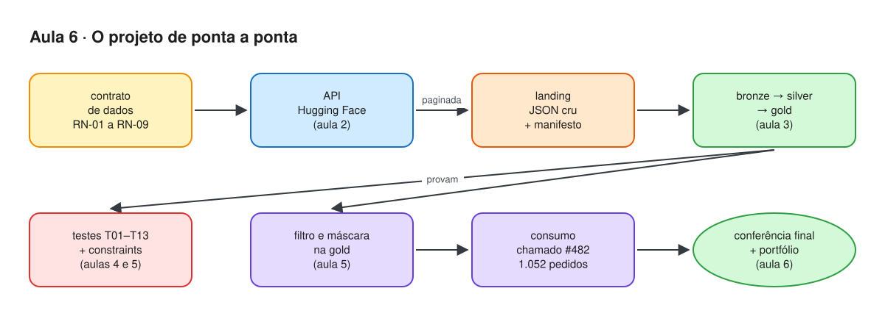

# Aula 6 · Validar o consumo e publicar

> Módulo 01 · Analytics Engineering com Databricks · ~25 min · Databricks Free Edition (custo R$ 0) + Claude Code

**Na última aula do módulo, a gold vira o que a Marina usa no dia a dia: um painel e um agente que responde em português, os dois com as regras do contrato. E o projeto inteiro vira um portfólio pronto para postar, com números que saíram das tabelas.**

| | |
|---|---|
| Você vai precisar de | as aulas [2](../aula-02-ingerindo-uma-api/) a [5](../aula-05-governanca-que-protege/) rodadas no mesmo catálogo · Databricks CLI · Claude Code ([instalação abaixo](#antes-da-aula-instalar-as-ferramentas)) |
| Você sai com | o **painel** da Marina publicado, o **agente** da Marina (Genie) e a pasta `meu-portfolio/` com README, post e ficha do projeto |
| Material | [slides](https://jennifer-maia.github.io/trilha-databricks-aulas/modulo-01-analytics-engineering/aula-06-validar-e-publicar/slides.html) (abre no navegador) · [anotações](anotacoes.md) · [quiz](https://jennifer-maia.github.io/trilha-databricks-aulas/quiz/?aula=06) · [exemplo de portfólio pronto](solucao/exemplo-portfolio/) |

> **Nomes de coluna atualizados (24/11/2026).** Para a gold não ter nome abreviado e a data do evento ficar mais clara, duas colunas mudaram de nome no material: `qtd_pedidos` → **`quantidade_pedidos`** (`gold.vendas_por_regiao`) e `event_ts` → **`event_timestamp`** (da silver em diante; na fonte e na bronze continua `event_ts`). Os vídeos das aulas 3 a 5 (e o começo desta) mostram os nomes antigos. Se você rodou a aula 3 antes dessa data, rode de novo o notebook [`aula03_transformacao.py`](../aula-03-transformacao-rastreavel/solucao/aula03_transformacao.py) e o da [aula 4](../aula-04-testes-que-provam/) antes de seguir.

## O que você vai aprender

- Entregar a gold do jeito que a área de negócio consome: um **painel** (AI/BI dashboard) e um **agente** (Genie).
- Por que o painel vai **sem credencial embutida**: cada pessoa vê com o próprio acesso, e o filtro da aula 5 continua valendo.
- Dar à IA **contexto, regras e parâmetros** antes de ela agir, num arquivo que o Claude lê primeiro.
- Gerar os números do portfólio a partir das tabelas, nunca digitados, e no perfil certo.

## O projeto, em desenho



Este desenho vai para o README do seu portfólio (o comando 04 já copia). O `.excalidraw` está em [`diagramas/`](diagramas/) se quiser editar.

## Antes da aula: instalar as ferramentas

Faça uma vez só, no seu computador. No Windows, recomendo usar o **WSL** (Ubuntu no Windows): os comandos abaixo e os scripts da aula foram testados em Linux.

### 1. Databricks CLI

É o programa de linha de comando do Databricks: os scripts da aula usam a CLI para criar o painel e o agente.

| Sistema | Comando |
|---|---|
| macOS ou Linux com Homebrew | `brew tap databricks/tap && brew install databricks` |
| Linux, macOS ou WSL sem Homebrew | `curl -fsSL https://raw.githubusercontent.com/databricks/setup-cli/main/install.sh \| sh` |
| Windows (fora do WSL) | `winget install Databricks.DatabricksCLI` |

Confira com `databricks -v`. Fonte: [instalar a Databricks CLI](https://docs.databricks.com/aws/en/dev-tools/cli/install).

Depois, conecte a CLI no **seu** workspace da Free Edition (o endereço é o que aparece no navegador, algo como `https://dbc-xxxx.cloud.databricks.com`):

```bash
databricks auth login --host https://<seu-workspace>.cloud.databricks.com --profile jornada
databricks current-user me --profile jornada      # deve mostrar o seu e-mail
```

O navegador abre para você entrar. `jornada` é só o nome que você dá a essa conexão (o **perfil**). Fonte: [autenticação OAuth da CLI](https://docs.databricks.com/aws/en/dev-tools/cli/authentication).

### 2. Claude Code

É o assistente de IA que roda no terminal e executa os comandos da aula. Precisa de uma conta Claude com plano pago (Pro ou Max) ou de uma conta na API da Anthropic.

| Sistema | Comando |
|---|---|
| macOS, Linux ou WSL | `curl -fsSL https://claude.ai/install.sh \| bash` |
| Windows (PowerShell) | `irm https://claude.ai/install.ps1 \| iex` |

Fonte: [instalar o Claude Code](https://docs.claude.com/en/docs/claude-code/setup). Confira com `claude --version`.

### 3. Skills do Databricks no Claude Code

As **skills** são instruções oficiais do Databricks que ensinam o Claude a usar a CLI, dashboards, Genie, jobs etc. Os comandos da aula funcionam sem elas, mas com elas o Claude acerta mais quando você pede algo fora do roteiro (um visual novo no painel, por exemplo). Escolha **um** dos dois jeitos:

```bash
# jeito 1: pela Databricks CLI (instala o plugin oficial no Claude Code)
databricks aitools install --agents claude-code

# jeito 2: de dentro do Claude Code
/plugin install databricks@claude-plugins-official
```

Fonte: [databricks-agent-skills](https://github.com/databricks/databricks-agent-skills). Confira com `databricks aitools list`.

> **E MCP?** O Databricks também oferece servidores MCP (outra forma de ligar a IA ao workspace). Nesta aula não precisa: os comandos usam a CLI.

### 4. Abrir o Claude Code no repositório

Os comandos da aula ficam em `.claude/commands/`, na raiz deste repositório. Abra o Claude Code **na raiz**:

```bash
cd trilha-databricks-aulas
claude
```

Digite `/aula06` e veja os 4 comandos aparecerem.

## O laboratório

### O que tem nesta pasta

```
aula-06-validar-e-publicar/
├── scripts/                              ← o que os comandos rodam (leia, são curtos)
│   ├── conferir_ambiente.py              ← comando 01
│   ├── painel_marina.json + criar_painel.py   ← comando 02
│   ├── criar_agente.py                   ← comando 03
│   ├── gerar_ficha.py                    ← comando 04
│   ├── trocar_perfil.py                  ← o erro de propósito (vendas Sudeste)
│   └── voltar_financeiro.py              ← se você ficou num perfil de teste
├── docs/modelo_contexto_claude.md        ← contexto, regras e parâmetros para o Claude
├── docs/modelo_readme_portfolio.md       ← esqueleto do README do portfólio
├── docs/modelo_post_linkedin.md          ← esqueleto do post
├── solucao/exemplo-portfolio/            ← como fica no final
├── solucao/aula06_conferencia_final.py   ← (opcional) confere as aulas 2 a 5 de uma vez
├── teste/aula06_conferir_projeto.py      ← (opcional) prova da conferência
├── meu-portfolio/                        ← criada pelos comandos: é o SEU portfólio
├── anotacoes.md · slides.html · img/ · diagramas/
```

Os comandos (`../../.claude/commands/aula06-*.md`) são textos curtos: abra e leia o que cada um pede ao Claude.

### Passo a passo

**Antes de tudo:** as aulas 2 a 5 rodadas no mesmo catálogo, e o seu perfil na tabela de acesso em `financeiro` (aula 5).

| Ordem | No Claude Code, digite | O que acontece | Resultado esperado |
|---|---|---|---|
| 1 | `/aula06-01-contexto jornada jornada_comercial` | Confere CLI, warehouse, tabelas, perfil e o 1.052; grava os parâmetros e escreve `meu-portfolio/CONTEXTO.md`, o manual com contexto, regras e parâmetros que o Claude lê antes de cada comando | `CONTEXTO.md` criado, sem `{{ }}` sobrando |
| 2 | `/aula06-02-painel` | Cria e publica o painel da Marina em cima de `gold.vendas_por_regiao`, **sem credencial embutida** | link do painel; total de **1.052** pedidos |
| 3 | `/aula06-03-agente` | Cria o agente da Marina (Genie) com as regras do contrato, faz uma pergunta e repete no perfil vendas Sudeste | **1.052** e R$ 2.302.177,12; no perfil vendas, **só o Sudeste** |
| 4 | `/aula06-04-portfolio` | Gera a ficha com números das tabelas e escreve `README.md` e `post-linkedin.md` | ficha com **1052**, README e post em `meu-portfolio/` |

Troque `jornada` pelo nome do seu perfil da CLI se você usou outro. Rodar um comando de novo **não duplica** nada: o painel e o agente são atualizados.

### Erro de propósito

| Erro | O que você vai ver | A lição |
|---|---|---|
| `python3 modulo-01-analytics-engineering/aula-06-validar-e-publicar/scripts/trocar_perfil.py vendas Sudeste` e depois o comando 04 | o script **para** e avisa: no perfil vendas, a ficha sairia com **528** pedidos, sem nenhum erro | com filtro de linha, o número depende de quem consulta. O script confere o perfil antes de contar |
| O agente cita uma regra errada (no nosso teste, citou RN-07 para explicar o filtro por região, que é a RN-08) | uma resposta convincente, com o número certo e a justificativa errada | o agente ajuda, mas quem garante o número é a gold testada. Confira a regra citada |

### Desafios (opcionais)

1. Pergunte ao agente 3 coisas suas (`/aula06-03-agente "sua pergunta"`) e confira uma delas na ficha.
2. Peça ao Claude: "adicione ao painel um gráfico de ticket médio por mês". Confira que ele mexeu só no `painel_marina.json` e rodou o script de novo.
3. Pergunte ao agente algo fora do contrato ("qual a taxa de devolução?") e o e-mail de um cliente. Ele deve recusar os dois.

## Checkpoint

| Onde | Esperado |
|---|---|
| Comando 01 | `meu-portfolio/CONTEXTO.md` com o seu perfil, catálogo e warehouse |
| Comando 02 | o painel abre e mostra **1.052** pedidos e R$ 2,3 mi |
| Comando 03 | o agente responde **1.052** e R$ 2.302.177,12; no perfil vendas Sudeste, só o Sudeste |
| Comando 04 | `meu-portfolio/ficha.md` com **1052** e as três contas (946 · 1060 · 1052) |

## Se algo der errado

| Aconteceu | Por quê | O que fazer |
|---|---|---|
| `/aula06...` não aparece no Claude Code | O Claude Code não foi aberto na raiz do repositório | `cd trilha-databricks-aulas` e `claude` de novo |
| `cannot configure default credentials` ou erro de login | A CLI não está conectada ou o perfil tem outro nome | `databricks auth profiles` e `databricks auth login ... --profile <nome>` |
| O comando 01 para em `gold.pedidos_concluidos` | As aulas 2 a 5 não rodaram neste catálogo | Rode as aulas e passe o catálogo certo |
| `Seu perfil é 'vendas'` | Você ficou num perfil de teste da aula 5 | Deixe o Claude rodar `voltar_financeiro.py` (ele pergunta antes) |
| O painel mostra menos de 1.052 | Você abriu o painel num perfil de vendas | Volte para financeiro e recarregue a página |
| No Windows, `python3` não existe | Fora do WSL o comando costuma ser `python` | Use o WSL, ou deixe o Claude trocar para `python` (ele vai pedir permissão) |

## Sua tarefa

1. Rode os 4 comandos até o checkpoint.
2. Tire os prints do painel e de uma conversa com o agente e salve em `meu-portfolio/prints/` (sem e-mail, URL do workspace nem nome de usuário).
3. Revise o `README.md` com as suas palavras (a seção "O que eu aprendi" é só sua) e copie a pasta `meu-portfolio/` para um repositório **seu** no GitHub.
4. Publique o post. Só números da ficha, e escrito que os dados são fictícios.
5. Faça o [quiz da aula](https://jennifer-maia.github.io/trilha-databricks-aulas/quiz/?aula=06).

## Fim do módulo

Você saiu de um pedido vago e chegou num número **certo, provado e protegido**, entregue num painel e num agente que seguem as mesmas regras, com o caminho de volta de cada número até a regra. O próximo módulo vai por dentro do Delta Lake: performance e custo.
