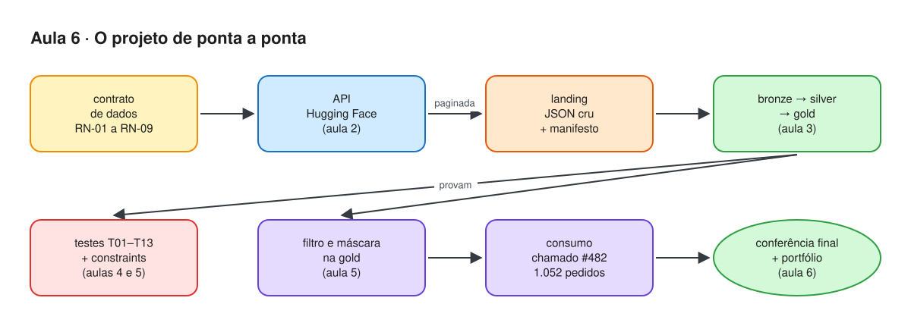

# Vendas por região: do pedido vago ao número protegido

Projeto de Analytics Engineering no Databricks (Free Edition), sobre uma loja online **fictícia**. **Todos os dados são fictícios**, gerados para estudo. Um pedido vago do comercial ("quero as vendas por região") virou um contrato de dados, um pipeline com regra rastreável, testes que provam cada regra, acesso controlado na própria tabela e, no fim, **um painel e um agente de IA** para a gerente consultar sozinha.

## O problema

O chamado #482 pediu as vendas concluídas por região, de agosto a outubro de 2026, sem duplicidade, porque o último relatório não bateu com o financeiro. Três pessoas com o mesmo pedido chegaram a três números diferentes: 946, 1060 e 1052. A diferença era o que ninguém tinha decidido: o que é "concluído", o que é "duplicado", qual status vale.

## O que eu fiz

| Etapa | O que faz | Por quê |
|---|---|---|
| Contrato de dados | 9 regras numeradas (RN-01 a RN-09) | decidir antes de codar |
| Ingestão de API | API do Hugging Face (datasets-server), paginada, com retry, validação de colunas, JSON cru + manifesto | a fonte manda; e "status 200" não prova que veio tudo |
| Bronze → silver → gold | cada regra com o número dela no código | qualquer número tem caminho de volta até a regra |
| Testes | contam linhas ruins, guardam histórico, constraints barram na entrada | um número só vale se existe um teste que pode falhar |
| Governança | filtro de linha por região (RN-08) e máscara de e-mail e telefone (RN-09) | a regra mora na tabela, não num documento |
| Painel (AI/BI dashboard) | pedidos, valor e vendas por região | publicado sem credencial embutida: cada pessoa vê só o que o perfil dela permite |
| Agente (Genie) | responde perguntas em português com as regras do contrato | recusa o que está fora do escopo e não mostra e-mail nem telefone |
| Contexto para IA | um arquivo com contexto, regras e parâmetros que o Claude Code lê antes de agir | a IA trabalha com o contrato, não com chute |

## Os números

Gerados a partir das tabelas gold, no perfil `financeiro` (em outro perfil o filtro por região corta o resultado).

| | |
|---|---|
| Clientes · produtos · pedidos · eventos | 500 · 60 · 1500 · 5416 |
| Pedidos concluídos (ago–out/2026) | 1052 |
| Valor de vendas | R$ 2.302.177,12 |
| Região que mais vendeu | Sudeste (52% do valor) |
| Regras de negócio | 9 (RN-01 a RN-09), cada uma com teste |
| Testes de qualidade na última rodada | 9 de 9 OK |

| Região | Pedidos | Valor |
|---|---:|---:|
| Sudeste | 528 | R$ 1.201.242,08 |
| Nordeste | 187 | R$ 372.291,30 |
| Sul | 158 | R$ 354.946,71 |
| Norte | 89 | R$ 202.398,72 |
| Centro-Oeste | 86 | R$ 158.721,48 |
| Não informada | 4 | R$ 12.576,83 |

## O que a gerente recebe

<!-- print do painel: prints/painel.png -->

<!-- print de uma conversa com o agente: prints/agente.png -->

## O que ficou de fora

O contrato definiu o escopo, e eu respeitei:

- Não trata devoluções, frete nem impostos: o valor é o `valor_liquido` (com desconto).
- Não tem análise por produto ou categoria.
- Não tem carga incremental: cada execução busca tudo de novo.
- Não é um ambiente de produção: roda na Free Edition, com dados fictícios, sem CI/CD.

## O que eu aprendi

- <uma frase sua sobre o erro que mais te ensinou>
- <uma frase sua sobre teste × constraint, ou sobre a view que não protege>
- <uma frase sua sobre o que faria diferente com dado de verdade>

## Como rodar

1. Crie uma conta na Databricks Free Edition.
2. Clone este repositório como Git folder.
3. Rode, nesta ordem: `setup/01_criar_ambiente`, a ingestão, a transformação, os testes e a governança. Todos com o mesmo catálogo no widget.
4. Com a Databricks CLI e o Claude Code instalados, rode os comandos `/aula06-01-contexto` a `/aula06-04-portfolio` para criar o painel, o agente e esta ficha.

## Créditos

Projeto feito na Trilha Databricks da Jornada de Dados. Dados fictícios, gerados para estudo.
