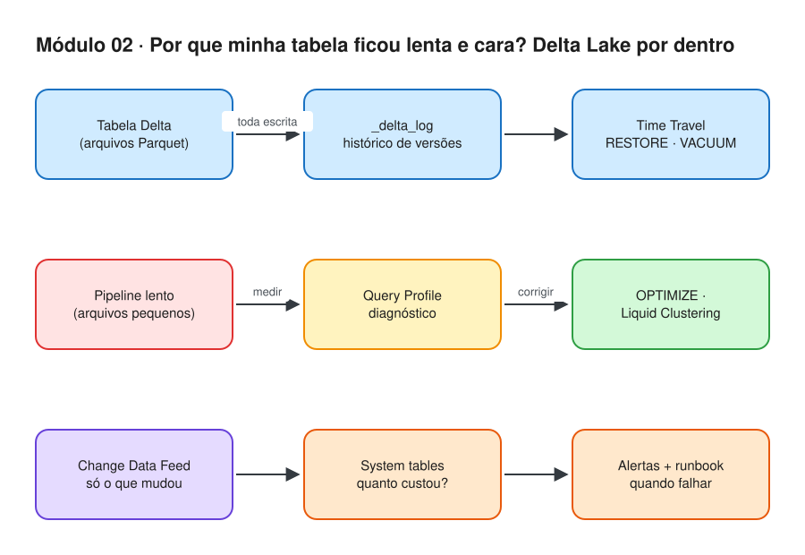

# Módulo 02 · Por que minha tabela ficou lenta e cara?

> Dezembro/2026 · ~4h em 5 aulas · apoia a certificação **Data Engineer Associate** · **em preparação**

**Promessa:** entender o que acontece por dentro de uma tabela Delta para diagnosticar lentidão, reduzir custo, processar só o que mudou e saber quando algo quebrou.

Este módulo é a porta de entrada da trilha de **Engenharia de Dados** de 2027.

## O cenário

Três meses depois, o produto de dados do Módulo 01 cresceu. A gerente reclama: o painel demora, a fatura subiu e ontem o dado não atualizou e ninguém percebeu. O laboratório começa com uma versão propositalmente ruim do pipeline, e você melhora passo a passo, medindo antes e depois.

Versão editável: [`diagramas/visao-geral.excalidraw`](diagramas/visao-geral.excalidraw) (abra em https://excalidraw.com).

## Aulas previstas

| # | Aula | O que você faz |
|---|---|---|
| 1 | Delta Lake por dentro | Abre o `_delta_log`, entende versões, histórico, Time Travel, `RESTORE` e `VACUUM` |
| 2 | Diagnóstico de performance | Lê o Query Profile, entende arquivos pequenos e data skipping, aplica `OPTIMIZE` e Liquid Clustering |
| 3 | Processar só o que mudou | Change Data Feed e carga incremental |
| 4 | Quanto custa e quando quebra | System tables de custo e execução, alerta de falha e um runbook de uma página |
| 5 | Relatório antes × depois | Fecha o portfólio com tempo, arquivos, bytes lidos e custo, antes e depois |

O conteúdo pode mudar até o lançamento. Lab, slides e diagramas de cada aula entram nesta pasta conforme forem publicados.
